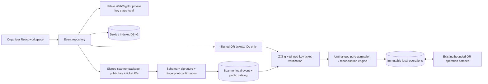

# Architecture · Phase 2B

The sections below describing Phase 2A are historical context; the Phase 2B section supersedes their unsigned real-event sync behavior.

The pure Phase 1 reconciliation engine and QR sync format are preserved. Real events sit around that engine, with native ticket verification at the admission boundary and public-key provisioning before offline use.

## Boundaries

No application backend, runtime CDN or external transfer API exists. Fonts, scanner code, CSS and app resources are bundled/precached locally. CSV parsing uses Papa Parse; crypto uses built-in WebCrypto, not a new signing dependency.

## Domain and identity

`src/features/check-in/domain/reconcile.ts` is unchanged (SHA-256 `db7489cba82d6c25b0d6a1f46986645d2cfa884ce821d7a2a6b1c3d5209bb86a`). It accepts immutable admissions, rejects local duplicates, deduplicates operation UUIDs, preserves distinct-ticket admission conflicts and never uses clocks as identity or conflict priority. Valid-set union remains idempotent, commutative and associative.

The legacy small `Event`/`Ticket` models remain for that engine/workbench. `ManagedEvent` adds real metadata, monotonic revision, public key/fingerprint, local role and locked-details flag. Event IDs are random UUIDs. Attendee IDs are UUIDs; ticket IDs are opaque random 88-bit hex values prefixed `T-` (24 characters total, compatible with the existing codec). Per-event ticket and email uniqueness are enforced by IndexedDB indexes. Collisions fail transactionally rather than overwriting rows.

Attendee names/emails remain organizer-local. Successful ticket verification produces the same existing CheckInRecord type: operation UUID, event ID, opaque ticket ID, scanner UUID and canonical timestamp. No personal fields enter the event log or sync tuple.

## Additive persistence migration

Keep database name `entryloop-v1-<profile>` and the existing v1 `operations`/`devices` tables. Dexie schema v2 adds:

| Table         | Key/index                                                            | Role                                                     |
| ------------- | -------------------------------------------------------------------- | -------------------------------------------------------- |
| events        | `id`, role, date                                                     | Event details, verification key, revision and role       |
| attendees     | `id`, eventId, unique `[eventId+email]`, unique `[eventId+ticketId]` | Organizer-only names/emails and stable ticket allocation |
| issuedTickets | `[eventId+ticketId]`, eventId, attendeeId                            | Organizer's retained signed token and issue time         |
| ticketCatalog | `[eventId+ticketId]`, eventId                                        | Opaque issued IDs on organizer/scanners                  |
| signingKeys   | eventId                                                              | Organizer-only non-exportable private CryptoKey          |

Migration does not rewrite/delete legacy logs or device identities. A dedicated regression creates an actual v1 DB, upgrades it and checks both. Profiles deliberately separate test databases but are not an origin/authorization boundary.

Create-event generation/hash completes before the event/key transaction. Attendee import validates all input before one transaction and rechecks email uniqueness under that transaction. Bulk signing completes outside IndexedDB transactions; a final transaction rechecks already-issued tickets and atomically adds tokens/catalog entries and locks event details. Concurrent issuance produces one retained token per attendee. Scanner initialization remains outside liveQuery; subscriptions only read.

## Editing safeguards

Name/date/location lock after first issuance or successful package export. Description remains editable. Event ID/key are never editable. Edits carry the revision loaded with the draft; later live-query updates do not silently advance that draft's base revision. Stale saves fail and require an explicit draft-discard/reload. Package revisions increase with event changes and new issuance.

## Tickets and trust

`signatures.ts` signs only a domain-separated canonical event/ticket ID message with ECDSA P-256/SHA-256. The private key is generated non-exportable and stored as a CryptoKey in IndexedDB. Public-only JWK coordinates and the SHA-256 canonical-key fingerprint may be exported. Key ownership is local; no identity service, recovery or key rotation exists.

Ticket token v1 is strictly `{k,v,e,t,s}` and capped at 512 UTF-8 bytes. Verification checks schema, expected event and native signature before reading/writing admissions. The final write transaction also checks prepared/issued membership and local duplicate status through the unchanged engine. Known local duplicates include operations learned through reconciliation.

Native WebCrypto signs/verifies raw 64-byte P-256 signatures. The ticket and package message domains differ to prevent cross-protocol signature reuse. Token/metadata fields are explicitly canonicalized, not dependent on input object key order. See README for exact formats.

## Scanner provisioning

Packages carry event metadata, public key, ticket IDs and a signature; they never serialize attendees, issued-ticket payloads or private keys. Strict parsing rejects unknown/private fields and duplicates. The file is bounded before JSON parse; crypto completes before the transaction.

Initial enrollment needs an independently obtained full fingerprint. A signature under a key included in the same file establishes consistency only. The confirmed key is pinned. Imports reject different pinned keys, lower revisions, conflicting equal revisions, removal of known tickets and replacement of organizer-role data. Equal canonical packages are idempotent; newer packages add prepared tickets while preserving existing operations. New tickets require re-export/import before those scanners accept them.

## Synchronization

The v1 `{v,e,r,h}` wire format, 5-record/900-byte limits, SHA-256 integrity and conflict semantics remain intact. Real-event imports validate opaque IDs against ticketCatalog; synthetic events retain their existing fixture checks. Merge/add remains transactional and every operation is preserved or the entire import fails.

**Sync operations are still unsigned.** A signed ticket does not authenticate a raw operation that omits the ticket proof. This is an explicit security boundary, shown in the product's Sync & conflicts view. Staff authorization and signed admission evidence require later work; this session does not relabel hashes as authentication.

## Presentation and offline resources

`ProductApp` routes with native browser URLs and cached index navigation fallback; no router dependency. Organizer forms, attendee manager, ticket manager, provisioning and scanner are separate modules. `/dev/workbench` directly renders the preserved synthetic workbench. Shared QR helpers retain the tested general/pure-image decoding paths and integer module sizing.

Digital tickets download as escaped SVG with a correctly scaled embedded QR. A self-contained HTML sheet uses scoped outer-SVG sizing so inner QR viewBoxes are preserved. Print layout/QR sizing are tested through real exported files and browser ZXing scanning. SVG image import can crop the actual QR pixels using the generated nested-SVG geometry, with finite size bounds and no token text extracted from markup; the decoded result still passes signature/event/catalog checks. Other images retain the general/pure decoder paths. No private key appears in either file.

The service worker precaches app assets and locally hosted fonts. Development-server behavior is not offline evidence. Normal reload and browser-process restart tests use production builds with network disabled. Service-worker updates use the existing waiting lifecycle; operators should close old app tabs to activate a new build, without clearing storage. New signed-ticket hardware scanning has not been validated on physical phones in this session.

## Phase 2B · Security boundary around the existing engine

The engine hash above is unchanged. No new dependency, backend, router or visual redesign was introduced. Native WebCrypto remains ECDSA P-256/SHA-256, raw 64-byte r||s signatures with base64url encoding. The same non-exportable-key generator serves independently generated organizer and scanner key pairs.

### Modules

| Module                         | Responsibility                                                                                                           |
| ------------------------------ | ------------------------------------------------------------------------------------------------------------------------ |
| `security/models.ts`           | Strict policy/credential/proof schemas, canonical JSON, domain separation and SHA-256                                    |
| `security/authority.ts`        | Local scanner identity, proof-of-possession enrollment, explicit organizer authorization and signed monotonic revocation |
| `security/operations.ts`       | Admission signing, pre-import verification, trusted projection, collision-safe atomic persistence and content roots      |
| `security/exchange.ts`         | Receiver-bound request/offer/data/missing/ack protocol, bounded batch preparation and durable recovery                   |
| `tickets/key-models.ts`        | Shared strict public-only JWK and signature shapes, avoiding schema dependency cycles                                    |
| `product/ScannerAuthority.tsx` | Enrollment, fingerprint review, credential/policy import and organizer revocation controls                               |
| `product/SecureSyncPanel.tsx`  | Transfer preparation, progress, resume, missing batches and acknowledgment feedback                                      |
| `product/SecurityTransfer.tsx` | Shared camera/image/file/payload input and actual QR output, using existing optical helpers                              |

### Additive Dexie v3

Database names and every previous table survive. Added `scannerKeys` (singleton local key/UUID/fingerprint), `credentials` (`[e+d]`), `policies` (`[eventId+epoch]`, append-only history), `operationProofs` (`[eventId+operationId]`) and `syncSessions` (`id`, event/direction indexes). No upgrade callback signs, deletes or relabels old operations. The old profile UUID remains available for the synthetic workbench; real admissions use the new key-bound UUID.

Canonical records remain in `operations`. Signatures are sidecars in `operationProofs`; this keeps pure domain models and reconciliation unchanged. The trusted projection verifies policy, credentials and signatures and excludes unsigned/revoked evidence. Main scanner/organizer attendance uses this projection. Raw records remain available in the scanner evidence ledger and IndexedDB. Known local legacy admissions still block a repeat ticket; investigate rather than promoting old records.

Crypto always finishes outside write transactions. Admission commit checks the exact policy again plus ticket membership and local duplicates. Import commit rechecks policy/catalog, operation identity, proof identity and credential identity, then writes records/proofs/credentials atomically. Receiving-session result counters are persisted in that same transaction, so a crash between log commit and acknowledgment creation does not lose the import receipt. Staged frames remain outside trusted logs until the full manifest and every author signature pass.

### Authorization and revocation

An event package pins an organizer verification key and installs a signed policy; it grants no scanner authority. Each scanner generates a non-exportable key and signs an event-specific enrollment request. The organizer compares the complete scanner fingerprint through direct observation/trusted communication, then explicitly signs its event/UUID/key/alias/grant-epoch credential. The scanner verifies the response with the pinned organizer key and requires its own local key/UUID. An organizer may explicitly authorize its own separately generated scanner identity.

Policy is a root-signed monotonically increasing epoch plus permanent revoked scanner/ticket IDs. A credential grants event authority until locally known revocation. Older grant epochs remain valid if the identity is not revoked. New policy snapshots must retain all previous revocations; same-epoch divergent content and rollback are rejected. New event-package v2 includes the policy under the package's separate signature. Policies can also travel as a bounded QR or JSON file. Grants need no roster-wide policy mutation; author credentials travel with sync snapshots when needed.

Revocation excludes all operations from that scanner or ticket, including earlier stored admissions, while preserving evidence. Client times cannot establish a trustworthy pre-revocation cutoff. Different policies/catalogs prevent secure exchange until devices are updated. Two equally stale devices can still agree with each other; no offline protocol proves they hold the latest organizer policy.

### Optical protocol v2

See [PROTOCOL_PHASE_2B.md](PROTOCOL_PHASE_2B.md) for exact signed messages, limits and acknowledgment semantics. A receiver request authenticates its key and creates a persistent random nonce. The sender prepares a complete immutable trusted snapshot, signs an offer bound to that nonce, and automatically creates credential/data frames. Frames arrive in any order after the offer. Missing indices are exact; each missing request covers at most 32. Staging, outgoing frames, requests and receipts survive browser restart subject to storage retention.

Each signed operation includes every existing record field, proof version, policy epoch and a hash of its organizer credential content. Signatures are not record identity. Different valid ECDSA signatures over identical signed content deduplicate; changed record or authorization content under an existing operation UUID rejects atomically. Snapshot roots include sorted canonical signed content, not randomized signature bytes. Trust context includes the pinned organizer fingerprint, current policy content and sorted ticket catalog.

A complete incoming snapshot verifies manifest identity/content root, author credentials and every operation before atomic merge. The intended receiver signs an acknowledgment containing offered root and its resulting full root. The sender verifies the expected receiver, request/session, context and roots. Extra receiver operations require reverse exchange. Completion is historical: subsequent admissions or authorization/catalog updates invalidate a current-match claim.

### Compatibility and limits

Signed ticket v1 remains unchanged. Package v1 remains parseable and can prepare a legacy event, but cannot authorize check-in and cannot downgrade an event with a policy. Export a v2 package, import it, then explicitly enroll. Legacy v1 operation exchange works only for the two synthetic workbench events. Unsigned real-event imports now fail visibly. Historical real-event unsigned records remain stored and excluded, never silently promoted.

The current protocol provides authenticated evidence, not proof that a person actually attended or that staff acted honestly. Same-origin compromise can invoke keys; exports do not encrypt opaque IDs. Physical phone optics, maximum-capacity throughput, storage eviction, secure recovery and key rotation remain unverified/unimplemented. Full UI/UX refinement remains Stage 4.
