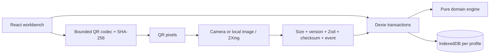

# Architecture

## Data flow

No transfer endpoint exists. All runtime dependencies and assets are bundled locally and precached by the production service worker. Browser camera permission, storage and the crypto API are platform boundaries.

## Domain

`Event`, `Ticket`, `ScannerDevice`, `CheckInRecord`, `SyncEnvelope`, `SyncResult` and `AdmissionConflict` are readonly TypeScript models. Record validation requires UUID operation/scanner IDs, bounded ASCII event/ticket IDs and a canonical UTC ISO timestamp including milliseconds. Records are successful admissions; locally rejected duplicate attempts are errors and are not falsely recorded as admissions. Rejection audit events would need a separate later model.

`createCheckIn` receives ID/time values from the persistence boundary. It does no I/O and reads no clock/random generator. It rejects known local duplicates. `reconcile` validates records, checks event identity and operation identity, computes set union, sorts by operation ID and groups by ticket. `mergeLogs` adds per-import counts; receipts are directional, while merged state is order-independent.

For valid sets where an operation ID maps to exactly one record, union is idempotent, commutative and associative. Same operations imply the same attendance/conflicts. A different record using an existing ID is not a valid set and rejects atomically; timestamps never arbitrate. Distinct IDs for the same ticket remain present and create a conflict. Attendance is the number of distinct ticket IDs; conflicts are the sorted tickets with more than one operation.

## Persistence

Dexie schema v1:

- Database: `entryloop-v1-<validated-profile>`.
- `operations`: primary key `[eventId+operationId]`, index `eventId`.
- `devices`: primary key `id`; scanner initialization uses a read/write transaction and creates one random UUID per database.

Admission reads and inserts in one read/write transaction. Import validates/decodes and hashes outside the transaction, checks synthetic membership, then reads/merges/adds in one transaction. Collisions or errors roll back the whole batch. Repeated operation IDs are skipped, not overwritten. No separate batch receipt database is needed for replay protection: immutable operation IDs provide that property across overlapping and differently packaged batches.

Scanner initialization happens before `liveQuery`; subscribed queries only read records. Another tab on the same database updates the live ledger. Events are filtered at every repository operation; reset targets the selected event and keeps identity. Profiles are a testing convenience, not an authorization boundary. Same-origin code can access other databases.

IndexedDB persistence is subject to quota, eviction, user clearing, private browsing and browser partitions. No durability or backup guarantee is claimed. The storage schema does not contain personally identifying attendee data in Phase 1.

## Transport

`codec.ts` is React/storage independent but uses WebCrypto at the transport boundary. Wire tuples remove repeated event IDs and verbose object keys. The format is described precisely in README.md. SHA-256 checks normalized compact `{v,e,r}` JSON; the record sequence remains part of the checksum. Key ordering in incoming JSON is normalized. No external compression or base64 overhead is used.

Before writes: UTF-8 size → parse → version → strict schema and record count → integrity → expected event → record reconciliation → synthetic membership → transactional merge. Imports reject as one batch. `BatchRejectedError` carries a record-entry count only when a bounded schema establishes it; malformed input has no invented count.

QR generation uses `qrcode` at H error correction. ZXing handles a camera stream or local image URL; no image is uploaded. Image decoding tries the general finder with TRY_HARDER and then the pure monochrome-QR pixel extraction path, which handles pristine screen captures that the finder can miss. The camera uses the general finder, since perspective/rotation cannot assume a pure QR image. Camera tracks stop on decode, explicit stop, error, cancellation or component cleanup. Normal optical misses/format/checksum decode exceptions are scan-search feedback, not imported operations. A successfully decoded text still passes all payload validation.

## PWA

`vite-plugin-pwa` generates Workbox precaching for HTML, JS, CSS, manifest and icons. Navigation falls back to the cached index. Scanner code is part of the local build, so first offline use does not trigger a CDN import. Updates wait for normal service-worker lifecycle; no forced reload interrupts a check-in. Offline status text is the browser's connectivity hint and service-worker control, not a guarantee of all hardware/storage behavior.

Installability configuration is implemented. Browser tests exercise production caching, offline reload and process restart; real mobile home-screen installation is unverified. `npm run dev` does not prove offline support. HTTPS or localhost is required. The optional TLS preview reads user-supplied certificate paths; no keys are generated or shipped by the app.

## Presentation

The workbench composes an event-scoped component, a transfer panel, camera adapter and operations ledger. State derives from Dexie and pure domain functions. Export uses explicit ledger selection, supports relay of imported records, and shows its generated snapshot count/size. Import receipts show actual decoded/committed/skipped/rejected counts. There is no remote delivery acknowledgment. Conflict evidence never disappears through a winner-selection rule.
